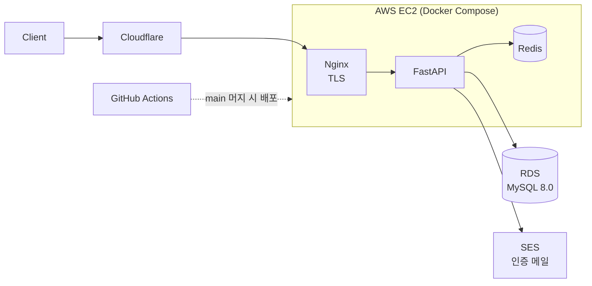

<div align="center">

# 💰 Finance Simulater — Backend

**월급 → 소비 → 투자 → 대출 → 상환**을 24개월 동안 가상으로 겪어 보는 금융 시뮬레이터

[](https://github.com/finance-simulater/backend/actions/workflows/test.yml)
[](https://finance-simulater.github.io/backend/)

[📘 API 문서 (Swagger)](https://finance-simulater.github.io/backend/)

</div>

---

## 📌 소개

사회초년생이 내 소비·투자·대출 선택이 **신용점수와 소비점수**에 어떤 영향을 주는지 직접 체험하도록 만든 서비스입니다.
1턴 = 1개월, 총 24턴 동안 진행됩니다.

```
회원가입 → 첫 월급 → 소비 체크 → 모의투자 → 대출 신청 → 상환 반복 → 완납·신용점수 상승
```

## ✨ 주요 기능

| 기능 | 설명 |
|---|---|
| 🔐 **인증** | 이메일 인증 회원가입 · JWT access token · HttpOnly 쿠키 refresh token(재발급 시 교체) |
| 🧾 **온보딩** | 급여·고정지출 등록, 가입과 동시에 시뮬레이션 시작 (현금 = 월급, 신용 50점) |
| 📅 **턴 진행** | 식비·쇼핑·여가 소비 수준 선택 → 월급 입금 · 지출 차감 · 소비점수 반영 |
| 📈 **모의투자** | 고변동 · 저변동 · 지수 3개 전략 매수·매도 |
| 🏦 **대출·신용** | 15단계 신용등급별 한도·금리 · 원리금균등상환 · 자동 상환/연체/부도 · 점수 이력 |

## 🛠 기술 스택

| 분류 | 사용 기술 |
|---|---|
| Backend | Python 3.13 · FastAPI · Pydantic v2 |
| Database | MySQL 8.0 · SQLAlchemy 2.0 · Alembic |
| Cache | Redis 7 (refresh token · 이메일 인증) |
| Infra | AWS EC2 · RDS · SES · Terraform · Docker Compose · Nginx · Let's Encrypt · Cloudflare |
| Frontend 호스팅 | AWS S3 · CloudFront |
| CI/CD | GitHub Actions (테스트 · EC2 배포 · API 문서 배포) |
| Test | pytest (단위 · 계약 · MySQL 통합) |

## 🏗 아키텍처



- API 스펙은 별도 spec 레포의 `openapi.yaml`을 **단일 출처(SSOT)** 로 삼고, 이 레포에 git 서브모듈로 연결합니다.
- 운영 서버는 현재 내려가 있으며, API 문서는 GitHub Pages로 제공합니다.

## 💡 설계 포인트

| 문제 | 해결 |
|---|---|
| 동시 요청으로 잔액이 꼬임 | 잔액을 바꾸는 요청(턴·매수·매도·대출)은 `SELECT … FOR UPDATE`로 잠금, 락 순서를 통일해 데드락 방지 |
| "활성 대출 1건" 규칙의 경쟁 조건 | DB unique 제약으로 최종 방어, 위반 시 `409`로 변환 |
| 턴 처리 중간 실패 시 일부만 기록됨 | 잔액 검사를 DB 기록 전에 수행 → 실패하면 아무것도 남기지 않음 |
| 스펙과 구현이 어긋남 | 계약 테스트가 실제 응답을 `openapi.yaml`로 검증 + CI가 spec 서브모듈 포인터 검사 |
| 토큰·인증번호 유출 위험 | Redis에 원문 대신 해시 저장, 타인 리소스는 존재 여부를 숨기려 `404` |
| 32bit INT 금액 오버플로 | 월 금액 상한(5천만원)·고정지출 개수 상한(30개)으로 24턴 누적에도 범위 유지 |

## 🧪 테스트

```bash
uv run pytest                  # 단위 · 계약 테스트
uv run pytest -m integration   # MySQL 통합 테스트 (docker compose 필요)
```

PR마다 GitHub Actions가 두 테스트를 모두 실행합니다 (MySQL 8.0 서비스 컨테이너).

## 🚀 로컬 실행

```bash
cp .env.example .env            # SECRET_KEY: openssl rand -hex 32
docker compose up -d            # MySQL · Redis
uv sync
uv run alembic upgrade head
uv run uvicorn app.main:app --reload
```

> `EMAIL_PROVIDER=console`이면 이메일 인증번호가 서버 로그에 출력됩니다.

<details>
<summary><b>📁 디렉터리 구조</b></summary>

```
app/
├── api/v1/       # 도메인별 router · schema · service · repository
│   ├── auth/  user/  fixed_expense/  simulation/
│   └── stock/  loan/  credit/  expense/
├── core/         # 설정 · 보안 · 예외 처리 · 공통 타입
└── health/       # /health · /health/ready
alembic/          # DB 마이그레이션
infra/            # Terraform (AWS)
nginx/  scripts/  # 리버스 프록시 · 인증서 · spec 포인터 검사
docs/             # 인증 · 배포 · 트러블슈팅 문서
tests/            # 단위 · contract · integration
```

</details>

## 📚 문서

- [인증 구조](docs/auth.md)
- [EC2 배포](docs/ec2-deploy.md)
- [트러블슈팅 기록](docs/troubleshooting.md)
